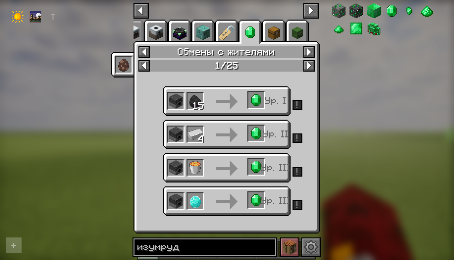
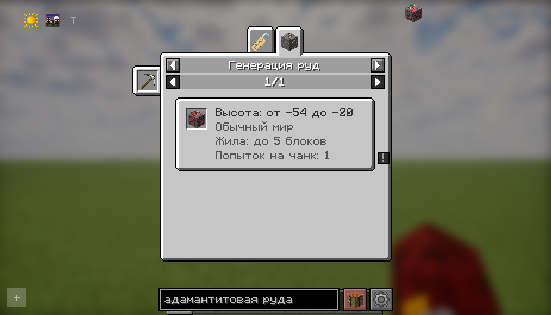
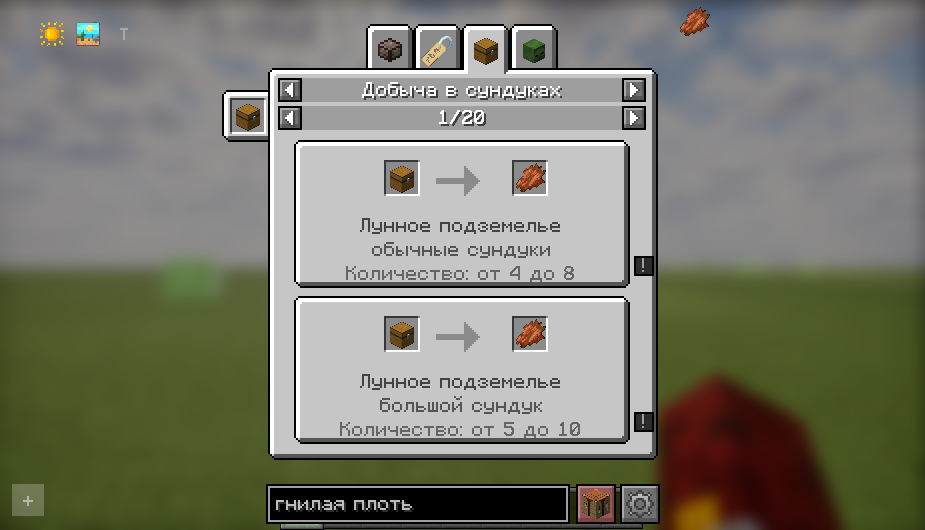
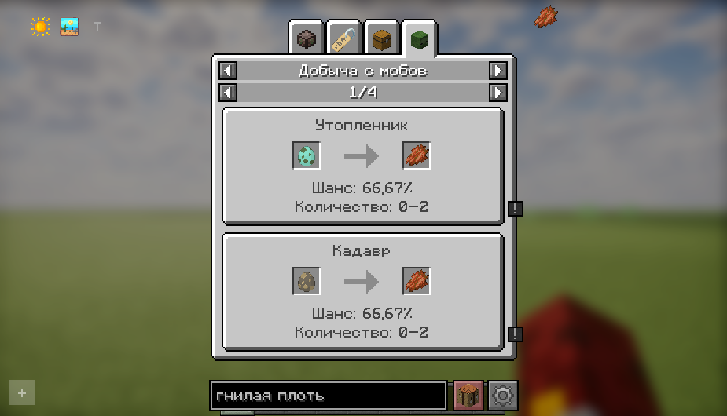

# Ozzz REI World Guide

Рецепт — не единственный способ получить предмет. Иногда проще купить его у жителя, найти в сундуке или добыть с моба. **Ozzz REI World Guide** собирает эти подсказки в REI, чтобы не приходилось каждый раз искать ответы в вики.

Версия **1.2.1** для **Minecraft 1.20.4 · Fabric**.

## Что добавляет мод

### Обмены с жителями

Показывает, что можно купить или продать, за какие предметы и на каком уровне профессии открывается сделка. Есть обмены со странствующим торговцем. Рабочий блок и подсказка помогают понять, какой житель нужен.

### Генерация руд

На карточке руды видны диапазон высот, измерение, размер жилы и число попыток генерации на чанк либо её редкость. Например, можно посмотреть, на какой высоте искать руду из Mythic Metals, не выходя из инвентаря.

Аддон читает поддерживаемые данные генерации установленных модов. Это сведения о правилах генерации, а не поиск залежей в вашем мире.

### Добыча в сундуках

Показывает, в каких сундуках встречается предмет: в ванильных постройках или модовых подземельях. Название места и зона добычи вынесены на отдельные строки — например, «Дворец Шираза» и «сокровища в библиотеке».

Для Minecraft, When Dungeons Arise и Ad Astra добавлены понятные русские названия. Количество на карточке относится к записи в таблице добычи; наличие предмета в каждом сундуке не гарантируется.

### Добыча с мобов

Показывает, из какого моба выпадает предмет, сколько его может выпасть и с каким шансом. Условия доступны при наведении на строку с шансом: например, требуется ли убийство игроком или должен ли моб гореть.

Шанс — это вероятность получить хотя бы один предмет за убийство. Поэтому у гнилой плоти из зомби указано **66,67%**, а не 100%: возможен результат от 0 до 2 предметов.

Модовые существа и предметы тоже подхватываются, если их добыча описана в поддерживаемых таблицах. Если точный процент вычислить нельзя, карточка сообщает, что он зависит от условий.

## Скриншоты

Снимки вкладок сделаны в игре с установленной версией 1.2.1. Остальные предметы и категории на экране относятся к установленной сборке.

## Требования

| Компонент | Версия для этой сборки |
| --- | --- |
| Minecraft | **1.20.4** |
| Загрузчик | **Fabric Loader**; проект собирается с 0.16.14 |
| Java | **17 или новее** |
| Roughly Enough Items (REI) | **14.1.727** для Fabric; минимум аддона — 14.1.727 |
| Fabric Language Kotlin | **1.10.20+kotlin.1.9.24** или новее |
| Fabric API | **0.97.0+1.20.4** |
| Architectury API | **11.1.17** для Fabric |
| Cloth Config API | **13.0.121** для Fabric |

Установите также Fabric API, Architectury и Cloth Config из списка — с этим комплектом библиотек проверялась сборка. Выбирайте выпуски под Minecraft 1.20.4. Совместимость со всеми более новыми версиями REI не заявляется.

**Устанавливается на клиент. На сервер добавлять аддон не требуется.** Версия для Forge не предлагается.

## Установка и использование

1. Установите Fabric и зависимости из списка выше.
2. Скачайте `OzzzREIWorldGuide-fabric-1.20.4-1.2.1.jar` и положите его в папку `mods`.
3. Если уже стоит предыдущий World Guide или REI Villager Trades 1.0.0, уберите старый JAR из `mods` перед запуском.
4. Наведите на предмет в REI и откройте способы получения — обычно клавишей **R**. Выберите нужную вкладку.

Если для предмета нет данных определённой категории, соответствующая вкладка может не появиться. Нужная клавиша зависит от настроек управления REI.

## Что стоит учитывать

- Проценты и количество добычи с мобов рассчитаны без зачарования «Добыча» и при удаче 0.
- В одиночной игре для мобов доступны итоговые таблицы мира, включая изменения датапаков и обработчиков таблиц. При подключении к серверу аддон использует данные клиентских модов: серверные правила могут отличаться.
- Поддержка модов зависит от формата данных. Предметы, выдаваемые напрямую кодом моба, индивидуальное снаряжение, нестандартные таблицы и отдельные сложные условия могут не отображаться или не иметь точного процента.
- Для руд и сундуков используются ресурсы установленных модов. Это не полная проверка всех серверных настроек и датапаков. Измерение руды определяется по известным признакам в данных; для необычной генерации возможны неточности.
- Цены некоторых случайных обменов, например зачарованных книг, служат ориентиром и могут отличаться от предложения конкретного жителя.

Аддон не добавляет свои руды, мобов или подземелья и не меняет их добычу.

